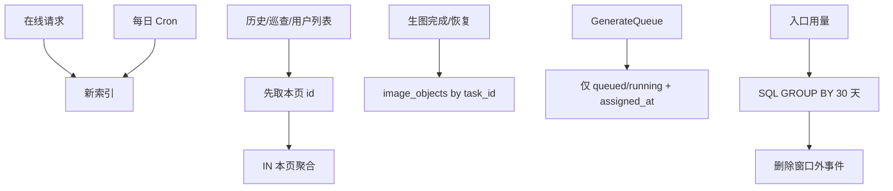

# D1 Rows read 优化需求

**版本**: v0.1  
**日期**: 2026-09-18  
**作者**: 用户 + AI  
**状态**: 已完成  
**关联任务列表**: [`tasks.md`](./tasks.md)

---

## 1. 背景

Cloudflare D1 的 **Rows read** 统计的是查询计划**扫过的行**（含 JOIN 中间结果、`COUNT(*)`、`OFFSET` 跳过的行），不是接口返回条数。会话、任务、图片元数据和漏斗事件只增不减后，若干高频接口和每日 Cron 会把该指标打上去。

2026-09-18 对当前代码与 schema 的审计结论：主要不是单次 `SELECT *` 返回太大，而是 **缺索引 + 先 JOIN 再 `GROUP BY`/`LIMIT` + 相关子查询按会话/用户放大**。

已确认的结构性缺口：

| 表                  | 高频条件                                                 | 现状                 |
| ------------------- | -------------------------------------------------------- | -------------------- |
| `sessions`          | `user_id` + `deleted_at` + `last_message_at`             | 除主键外无索引       |
| `tasks`             | `session_id`、`message_id`、`assigned_at`、`finished_at` | 无对应索引           |
| `image_objects`     | `task_id`、`session_id`、`deleted_at`                    | 无对应索引           |
| `generation_events` | `created_at` + `is_sysadmin_preview`                     | 现有索引对不上该过滤 |
| `audit_logs`        | Cron `COUNT(*)`                                          | 无索引；全表计数     |

P0 查询形状（数据变大后 Rows read 近似「表行数 × 子查询/JOIN 倍数」）：

- [`GET /api/history`](../../../server/src/routes/sessions/history.ts)：无 `sessions.user_id` 索引；每行多次 `tasks.session_id` / `json_each(attachments)` 相关子查询；`OFFSET` 分页。
- [`GET /api/sysadmin/users/:id/sessions`](../../../server/src/routes/sysadmin/auditSessions.ts)：`LEFT JOIN tasks` 后再 `GROUP BY`；`userId=_` 时扫全站会话。
- [`GET /api/admin/users`](../../../server/src/routes/admin/users.ts)：`LEFT JOIN tasks` 后 `GROUP BY users.id` 再 `LIMIT/OFFSET`；`LIKE '%q%'` 不能走唯一索引。
- 按 `task_id` / `session_id` 查 [`image_objects`](../../../server/src/lib/tasks/taskImages.ts)：生图完成、恢复、历史详情均全表扫。
- 每日 Cron [`logD1TableSizes` / `backupOperationalSnapshot`](../../../server/src/lib/operations.ts)：对主表 `COUNT(*)` / `GROUP BY` 全表。

本需求在**不改变产品行为**的前提下，把这些路径的 Rows read 从「随历史全量线性/乘性增长」压回「随本页结果或活跃工作集增长」。

---

## 2. 目标

### 2.1 范围内

- 为审计列出的热路径补 D1 索引（Drizzle schema + 审阅后的 migration）。
- 改写 P0 列表查询：先按索引取出本页主键，再对 `IN (本页 id)` 聚合；禁止「全量 JOIN 任务表再 `GROUP BY` + `OFFSET`」。
- 热路径按 `task_id` / `session_id` / `message_id` 联查必须能走索引。
- 看板、生成入口 30 天用量、密钥 `activeSlots` 改为 SQL 聚合或只扫 `queued/running`，禁止为计数拉取窗口内全部事件行或该 key 的历史任务。
- `generation_events` 超过用量窗口的行由 Cron 清理；用量查询与 30 天产品语义一致。
- 调度器统计 key slot 时只扫活跃任务，不扫终态历史。
- 补回归测试与 `EXPLAIN QUERY PLAN`（或等价）断言，证明新索引被使用、列表查询不再依赖全表任务 JOIN。
- 同步 [`DATABASE.md`](../../DATABASE.md)、[`RELIABILITY.md`](../../RELIABILITY.md)、[`OPERATIONS.md`](../../OPERATIONS.md)、[`EXPERIMENTS.md`](../../EXPERIMENTS.md)。

### 2.2 范围外

- 不改用户可见的列表字段、权限模型和错误码，除非某条任务显式记录兼容变更。
- 不把历史/管理列表从 `page/pageSize/total` 改成游标分页（可在索引落地后评估，不在本期）。
- 不引入 Cloudflare Queues、Analytics Engine、外部数仓或物化汇总表（第一期用索引 + 查询改写 + 事件 TTL）。
- 不做 `LIKE '%q%'` 全文检索引擎；搜索仍可全表/用户范围内扫描，但不得再 JOIN 全量 `tasks`。
- 不清理或归档 `tasks` / `messages` / `sessions` / `audit_logs` 历史行（软删语义保持）。
- 不重做前端视觉、案例库产品形态、任务中心轮询间隔（轮询可列为后续观察项，不作为本期必做）。
- 不把 sysadmin 案例管理全量列表、公告正文 `LIKE` 搜索作为 P0（表小，见 §8 后续）。

### 2.3 成功标准

- 带 `user_id` 的会话列表、历史列表、管理用户列表在「先取页再聚合」后，查询计划不再对整张 `tasks` 做无界 JOIN。
- 新增索引出现在 schema 与已审阅的 migration 中；本地 `pnpm -F server db:migrate:local` 可应用。
- `GET /api/sysadmin/generation-entry` 的 30 天用量在 SQL 侧 `GROUP BY`，不把窗口内每一行拉进 Worker。
- 密钥列表 `activeSlots` 只统计 `queued/running` 且 `assigned_at IS NOT NULL` 的行。
- 现有历史封面、任务数、管理用户 `generationCount` / `lastGenerationAt`、巡查 `imageCount` 的**响应语义不变**。
- `pnpm -F server test`、`pnpm -F server typecheck` 通过；若改前端契约则 `pnpm -F web test` / `typecheck` 同步通过。

---

## 3. 用户场景

本期主要是运维与规模化，终端用户旅程不变。下列场景用于验收「看起来一样、扫行变少」。

### 3.1 用户打开历史页

**角色**: 已登录 user / admin  
**前置条件**: 该用户有大量历史会话与任务。

**步骤**:

1. 打开历史列表第一页。
2. 翻到较后页。
3. 用标题或 prompt 关键词搜索。
4. 点开一条历史详情。

**预期结果**: 列表字段（任务数、请求张数、封面、状态）与现网一致；D1 对该请求的 Rows read 随**本页会话数**增长，而不是随全站 `tasks` 行数增长。

### 3.2 Sysadmin 巡查会话

**角色**: sysadmin  
**前置条件**: 全站会话与图片元数据已积累。

**步骤**:

1. 按指定用户列会话。
2. 使用 `userId=_` 列全站会话（若产品仍提供该入口）。
3. 打开单会话详情。

**预期结果**: 任务数、成功图数量、封面图与现网一致；全站列表不得先把全部 `tasks` JOIN 进结果再分页。

### 3.3 Admin 打开用户列表

**角色**: admin / sysadmin

**步骤**:

1. 打开用户列表第一页。
2. 按邮箱/用户名/昵称搜索。
3. 查看某用户用量。

**预期结果**: `generationCount`、`lastGenerationAt`、配额字段正确；列表查询不得为了这两列扫完整张 `tasks`。

### 3.4 生图完成与恢复

**角色**: 系统（GenerateQueue / Workflow / recovery）

**步骤**:

1. 用户提交生成。
2. 调度器选 key、占用 slot、任务终态释放。
3. Cron 或请求路径触发中断恢复。

**预期结果**: 按 `task_id` 加载/清理生成图、按 `session_id` 补历史图、按 `message_id` 联任务均走索引；调度 slot 计数只看活跃任务。

### 3.5 Sysadmin 看入口用量与看板

**角色**: sysadmin

**步骤**:

1. 打开生成入口设置（含 30 天提交/成功/失败）。
2. 打开运营看板（可能命中 60s KV 缓存）。

**预期结果**: 数字与现网窗口语义一致；用量查询不下载 30 天全部 `generation_events` 行。

---

## 4. 功能需求

### F1: 热路径索引

**描述**: 在 [`server/src/db/schema.ts`](../../../server/src/db/schema.ts) 增加索引，生成 migration 并人工审阅。

**建议索引**（实施时可按 `EXPLAIN QUERY PLAN` 微调列序，不得无故删列）：

| 索引名                                  | 列                                       | 服务的查询                       |
| --------------------------------------- | ---------------------------------------- | -------------------------------- |
| `idx_sessions_user_last`                | `(user_id, deleted_at, last_message_at)` | 侧栏会话、历史列表、用户维度巡查 |
| `idx_tasks_session`                     | `(session_id)`                           | 历史/巡查/删会话按会话聚合任务   |
| `idx_tasks_message`                     | `(message_id)`                           | 消息列表 `LEFT JOIN tasks`       |
| `idx_image_objects_task`                | `(task_id, deleted_at)`                  | 任务完成/恢复加载与清理生成图    |
| `idx_image_objects_session`             | `(session_id, deleted_at, is_reference)` | 历史/巡查按会话拉非参考图        |
| `idx_image_objects_deleted`             | `(deleted_at)`                           | Cron 物理清理软删图              |
| `idx_tasks_status_assigned`             | `(status, assigned_at)`                  | 调度 slot、重置 stale assigned   |
| `idx_tasks_status_finished`             | `(status, finished_at)`                  | 失败摘要近 24h                   |
| `idx_generation_events_created_preview` | `(created_at, is_sysadmin_preview)`      | 30 天用量与 TTL 删除             |

**验收标准**:

- [x] Schema 与 migration 一致，命名符合现有 `idx_*` 约定。
- [x] 不删除现有索引与列。
- [x] [`docs/DATABASE.md`](../../DATABASE.md) 记录新增索引及用途。
- [x] 本地迁移可重复应用。

### F2: 历史列表先分页再聚合

**描述**: 改写 [`server/src/routes/sessions/history.ts`](../../../server/src/routes/sessions/history.ts) 的列表 SQL。

**行为**:

1. 用 `sessions.user_id` + `deleted_at` + 排序键选出本页会话（保留现有 `page` / `pageSize` / `total` / `q` / `order`）。
2. 仅对本页 `session_id` 计算 `task_count`、`requested_image_count`、`image_count`、`session_status`、封面。
3. `COUNT(*)` 总条数不得 JOIN `tasks`。
4. 搜索仍可用 `title LIKE` 与 `messages.prompt LIKE` 的 `EXISTS`，但外层必须先限制在当前用户未删会话。

**验收标准**:

- [x] 响应 JSON 字段与现网一致（含封面与 `requestedImageCount` 取 max 规则）。
- [x] 查询不再 `LEFT JOIN tasks ON tasks.session_id = sessions.id` 后再对全用户会话 `GROUP BY`。
- [x] 有测试锁定聚合语义（任务数、封面 id、进行中状态优先于 queued）。

### F3: 管理用户列表与用量

**描述**: 改写 [`GET /api/admin/users`](../../../server/src/routes/admin/users.ts)。

**行为**:

- 分页、筛选、搜索仍在 `users`（及配额、key group）上完成。
- `generationCount` / `lastGenerationAt` 只针对**本页用户 id** 聚合，或使用相关子查询且内层能走 `idx_tasks_user_queued`。
- `LIKE '%q%'` 可保留；不得为了搜索再 JOIN `tasks`。
- `GET /users/:id/usage` 保持按单用户聚合；确认走 `user_id` 索引即可，不作为 P0 改写。

**验收标准**:

- [x] 列表 20 条时不会扫描所有用户的全部任务行才能 `GROUP BY`。
- [x] admin 只能看到名下用户的既有权限不变。
- [x] 搜索结果的计数列与点进用量页的总数可对上（允许进行中任务造成的短暂差，与现网一致）。

### F4: Sysadmin 会话巡查列表

**描述**: 改写 [`auditSessions.ts`](../../../server/src/routes/sysadmin/auditSessions.ts) 列表查询。

**行为**:

- 指定 `userId` 时走 `sessions.user_id` 索引。
- `userId=_` 仍允许全站列表，但必须「先 LIMIT 本页会话，再聚合」；禁止 `LEFT JOIN tasks` 膨胀后再 `GROUP BY`。
- `image_count` / 封面改为对本页会话的 `IN` 查询或受索引约束的相关子查询。
- 详情接口保持消息上限 200 与现有合并规则（用户历史不展示 audit-only 持久化图，巡查可见）。

**验收标准**:

- [x] `userId=_` 第一页的 Rows read 不随全站 `tasks` 行数线性乘会话数。
- [x] 封面与 `imageCount` 语义与现网一致。
- [x] [`historyImages.test.ts`](../../../server/test/historyImages.test.ts) 的可见性约定不被破坏。

### F5: 图片与消息热路径走索引

**描述**: 生图完成、恢复、历史详情、巡查详情、软删清理均按 `task_id` / `session_id` 访问 `image_objects`；消息列表按 `message_id` 联 `tasks`。

**涉及**:

- [`taskImages.ts`](../../../server/src/lib/tasks/taskImages.ts)
- [`historyImages.ts`](../../../server/src/routes/sessions/historyImages.ts)
- [`auditSessionImages.ts`](../../../server/src/routes/sysadmin/auditSessionImages.ts)
- [`messages.ts`](../../../server/src/routes/sessions/messages.ts)
- [`cleanup.ts`](../../../server/src/lib/cleanup.ts)
- 会话软删时 `SELECT status FROM tasks WHERE session_id = ?`

**验收标准**:

- [x] 上述 SQL 的 `EXPLAIN QUERY PLAN` 使用 F1 索引，而不是对 `image_objects` / `tasks` 全表扫描。
- [x] 清理仍单次最多 100 条；行为不变。

### F6: 用量、看板、密钥 slot、调度统计

**描述**: 把「计数类」查询改成聚合或活跃子集扫描。

| 入口                                                                                     | 现状                                                                    | 目标                                                                                                                        |
| ---------------------------------------------------------------------------------------- | ----------------------------------------------------------------------- | --------------------------------------------------------------------------------------------------------------------------- |
| [`getGenerationPageUsageMetrics`](../../../server/src/lib/generationEntry.ts)            | 拉 30 天全部事件行在 JS 里计数                                          | `GROUP BY route, event_name`                                                                                                |
| [`GET /api/sysadmin/dashboard/stats`](../../../server/src/routes/sysadmin/dashboard.ts)  | `users LEFT JOIN tasks` 再 Top 10；`queued_at` 无索引扫全表做 30 日趋势 | 先 `tasks GROUP BY user_id` 再 JOIN；趋势尽量用已有 `(user_id, queued_at)` 或可接受的 status/queued 计划，避免无谓全表 JOIN |
| [`GET /api/sysadmin/provider-keys`](../../../server/src/routes/sysadmin/providerKeys.ts) | `LEFT JOIN tasks` 全历史再 `SUM(CASE queued/running)`                   | 只统计 `status IN ('queued','running') AND assigned_at IS NOT NULL`                                                         |
| [`getNextAvailableProviderKeySlot`](../../../server/src/lib/tasks/scheduler.ts)          | 子查询扫全部 queued/running                                             | 使用 `(status, assigned_at)`；语义不变                                                                                      |

看板 KV 60s 缓存保留。

**验收标准**:

- [x] 生成入口 30 天 submitted/succeeded/failed 与现网事件名过滤一致（仍排除 `isSysadminPreview`）。
- [x] 密钥列表 `activeSlots` 与调度器占用定义一致：queued/running 且已 `assigned_at`。
- [x] Top 用户仍按任务数降序最多 10 条。

### F7: 事件 TTL 与 Cron 读放大

**描述**:

- Cron 删除 `generation_events.created_at` 早于用量窗口（默认 30 天）的行；可设单次上限以免长事务。
- `logD1TableSizes` / `backupOperationalSnapshot` 仍可每日全表 `COUNT(*)`（这是有意的体检），但须在文档中标明会贡献约「主表行数之和」的 Rows read，避免与列表优化混为一谈。
- `sendFailureDigest` 使用 `(status, finished_at)` 索引。
- `cleanupDeletedImages` 使用 `deleted_at` 索引。

**验收标准**:

- [x] 超过窗口的事件不再出现在用量查询中，也尽快从 D1 删除。
- [x] 文档写清 Cron 全表计数是已知、有界的每日成本。
- [x] 失败摘要仍只统计近 24h `status='failed'`。

### F8: 测试与文档

**描述**: 用 Miniflare D1 覆盖查询改写与索引；文档成为当前真相。

**验收标准**:

- [x] 新测试覆盖 F2–F6 的响应语义或查询计划（至少覆盖历史列表聚合、管理用户计数不 JOIN 全表、用量 SQL 聚合、slot 只计活跃任务）。
- [x] 现有 `historyImages`、`queueScheduler`、`generationEntry`、`apiPermissions` 回归通过。
- [x] `DATABASE` / `RELIABILITY` / `OPERATIONS` / `EXPERIMENTS` / 本执行计划状态同步。

---

## 5. 非功能需求

### 5.1 性能

- 目标形态：带用户范围的列表 Rows read = O(该用户会话数或本页大小 + 本页关联行)，而不是 O(全站 tasks × 会话数)。
- 全站 sysadmin 列表允许扫 `sessions` 本页之前的 OFFSET 行，但不允许为此 JOIN 全量 `tasks`。
- 不把「每日 Cron 全表 COUNT」当作失败；把它与在线请求路径分开衡量。

### 5.2 安全与权限

- 历史、管理、巡查的数据边界不变（本人 / `createdBy` / sysadmin）。
- 查询改写不得把其他用户的任务或图片聚合进当前页。
- 密钥明文、`encrypted_key` 仍不得进入日志或列表响应。

### 5.3 兼容

- HTTP 路径、查询参数、JSON 字段名保持兼容。
- 前端任务中心 5s/30s 轮询本期不改；索引落地后 `GET /api/tasks` 的 `image_objects.task_id` 扫描应自然下降。

### 5.4 迁移与发布

- 走 `pnpm -F server db:gen`，人工审阅 SQL 后提交。
- 生产必须先应用 migration 再部署依赖新索引的查询；若查询改写与索引同版本发布，需在 [`OPERATIONS.md`](../../OPERATIONS.md) 写明部署顺序。
- 索引可加不可乱删；回滚 Worker 代码时索引可保留。

### 5.5 可观测性

- 不新增用户可见 UI。
- 可选：在改写后的重查询路径打结构化日志（耗时、`rows_read` 若 D1 meta 暴露）。非验收阻塞项。

---

## 6. 技术方案

### 6.1 查询改写模式（统一）

```text
1. 过滤 + 排序 + LIMIT/OFFSET 只打驱动表（sessions / users）
2. 收集本页 id
3. 对 id IN (...) 做聚合（COUNT/MAX/封面子查询）
4. 在应用层按本页顺序拼回响应
```

禁止：

```sql
SELECT ... FROM users
LEFT JOIN tasks ON tasks.user_id = users.id
GROUP BY users.id
ORDER BY users.created_at DESC
LIMIT ? OFFSET ?
```

### 6.2 模块

| 模块                                                                                                      | 调整                           |
| --------------------------------------------------------------------------------------------------------- | ------------------------------ |
| [`server/src/db/schema.ts`](../../../server/src/db/schema.ts)                                             | 新增 F1 索引                   |
| `server/migrations/`                                                                                      | 新 SQL，审阅后提交             |
| [`sessions/history.ts`](../../../server/src/routes/sessions/history.ts)                                   | F2                             |
| [`admin/users.ts`](../../../server/src/routes/admin/users.ts)                                             | F3                             |
| [`sysadmin/auditSessions.ts`](../../../server/src/routes/sysadmin/auditSessions.ts)                       | F4                             |
| [`taskImages.ts`](../../../server/src/lib/tasks/taskImages.ts) 等                                         | F5，以索引为主，SQL 形状可保持 |
| [`generationEntry.ts`](../../../server/src/lib/generationEntry.ts)                                        | F6 聚合 + F7 TTL 删除函数      |
| [`sysadmin/dashboard.ts`](../../../server/src/routes/sysadmin/dashboard.ts)                               | F6 Top 用户                    |
| [`sysadmin/providerKeys.ts`](../../../server/src/routes/sysadmin/providerKeys.ts)                         | F6 activeSlots                 |
| [`tasks/scheduler.ts`](../../../server/src/lib/tasks/scheduler.ts)                                        | F6 slot 子查询                 |
| [`lib/operations.ts`](../../../server/src/lib/operations.ts) / [`index.ts`](../../../server/src/index.ts) | F7 事件清理挂入 Cron           |
| [`server/test/`](../../../server/test/)                                                                   | F8                             |

### 6.3 架构关系



### 6.4 风险

| 风险                                         | 缓解                                                          |
| -------------------------------------------- | ------------------------------------------------------------- |
| 聚合拆成多语句后语义漂移（封面、进行中状态） | 用现网规则写黄金用例；对比改写前后 fixture                    |
| SQLite 对 `IN (本页)` 仍选错计划             | 任务内强制 `EXPLAIN QUERY PLAN`；必要时 `+idx` 或改相关子查询 |
| 索引增加写入放大                             | 只加审计确认的热路径；不建冗余宽索引                          |
| 事件 TTL 误删窗口内行                        | 删除条件 `created_at < window.since`，与用量查询同一窗口函数  |
| 迁移未上生产导致新 SQL 更慢                  | OPERATIONS 写清「先 migrate 再 deploy」                       |

---

## 7. 验收命令

```bash
pnpm -F server test
pnpm -F server typecheck
```

若查询改写未动 Vue 契约，前端测试非必须；动了则：

```bash
pnpm -F web test
pnpm -F web typecheck
```

发布前仍以 [`TESTING.md`](../../TESTING.md) 全量检查为准。生产验证：Cloudflare D1 Metrics 中列表类请求的 Rows read 在数据量上升时不再随 `tasks` 全表线性爆炸（每日 Cron 全表 COUNT 除外）。

---

## 8. 后续（明确不做）

- 历史/巡查改为游标分页，消除大 `OFFSET`。
- `tasks` / `audit_logs` / 软删会话的归档或分区。
- 任务中心轮询降频。
- sysadmin 案例管理全量列表、公告 `content LIKE`。
- 物化日汇总表或 Analytics Engine。

---

## 9. 相关文档

- [`tasks.md`](./tasks.md)
- [`../README.md`](../README.md)
- [`../../DATABASE.md`](../../DATABASE.md)
- [`../../RELIABILITY.md`](../../RELIABILITY.md)
- [`../../OPERATIONS.md`](../../OPERATIONS.md)
- [`../../EXPERIMENTS.md`](../../EXPERIMENTS.md)
- [`../../QUALITY_SCORE.md`](../../QUALITY_SCORE.md)
