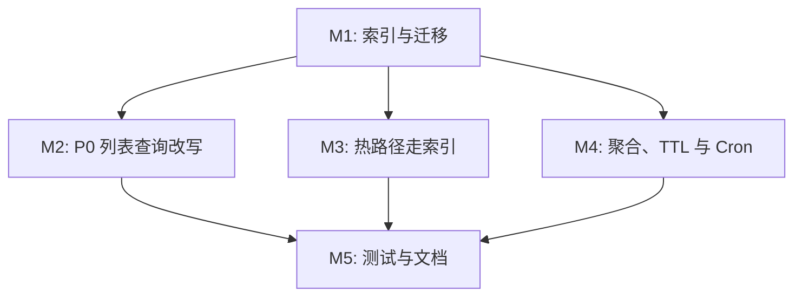

# 任务列表 — D1 Rows read 优化

**关联需求**: [`requirements.md`](./requirements.md)  
**估算量级**: 中大型，15 个本期任务 + 1 项后续 DEFERRED，以后端 schema、查询改写与测试为主  
**总体进度**: 15 / 15  
**状态**: DONE

---

## 状态图例

| 状态     | 含义                               |
| -------- | ---------------------------------- |
| TODO     | 待开始                             |
| DOING    | 进行中                             |
| REVIEW   | 实现完成，待人工或最终审核         |
| DONE     | 已完成并通过验证                   |
| BLOCKED  | 被外部决策或不可自行解决的问题阻塞 |
| DEFERRED | 有意延后，不属于当前批次           |

---

## 里程碑依赖图

实施顺序建议：先落地 M1 迁移，再改写 M2/M4 查询（避免无索引的新 SQL 更慢），M3 以确认计划为主。

---

## Milestone 1: 索引与迁移

**目标**: 热路径列可被 SQLite 使用，且迁移可审阅、可重复应用。  
**依赖**: 无  
**状态**: DONE

### D1R-001 DONE 在 Drizzle schema 声明热路径索引

**描述**: 按需求 F1 在 `schema.ts` 增加 sessions / tasks / image_objects / generation_events 索引；不删现有索引。

**依赖**: 无  
**阻塞**: D1R-002, D1R-003  
**预估**: 1.5h

**关联文件 / 模块**:

- [`server/src/db/schema.ts`](../../../server/src/db/schema.ts)
- [`requirements.md`](./requirements.md) §F1

**验收**:

- [ ] 索引名与列序与需求表一致，或在任务备注写明 `EXPLAIN` 导致的列序调整。
- [ ] 字段命名仍遵循 camelCase / SQLite snake_case。
- [ ] 导出的表定义可通过 `pnpm -F server typecheck`。

#### 备注

- 遇到的问题:
- 最终实现逻辑:
- 关键决策:

---

### D1R-002 DONE 生成并审阅 D1 migration

**描述**: `pnpm -F server db:gen`，人工审阅 SQL（只 `CREATE INDEX`，无删表/删列），本地 `db:migrate:local`。

**依赖**: D1R-001  
**阻塞**: D1R-004, D1R-005, D1R-006, D1R-007, D1R-010, D1R-011, D1R-014, D1R-015  
**预估**: 1.5h

**关联文件 / 模块**:

- `server/migrations/`
- [`docs/OPERATIONS.md`](../../OPERATIONS.md)

**验收**:

- [ ] migration 可在空库与已有本地库重复应用。
- [ ] SQL 无意外 `DROP`。
- [ ] OPERATIONS 注明生产「先 migrate 再 deploy Worker」。

#### 备注

- 遇到的问题:
- 最终实现逻辑:
- 关键决策:

---

### D1R-003 DONE 更新数据库文档中的索引清单

**描述**: 在 DATABASE 写明新索引、服务的查询，以及「列表类优化 vs 每日 Cron 全表 COUNT」的区别。

**依赖**: D1R-001  
**阻塞**: D1R-015  
**预估**: 0.5h

**关联文件 / 模块**:

- [`docs/DATABASE.md`](../../DATABASE.md)

**验收**:

- [ ] 读者能从文档找到每个新索引对应的接口或 Cron。
- [ ] 不把尚未落地的查询改写写成已完成行为。

#### 备注

- 遇到的问题:
- 最终实现逻辑:
- 关键决策:

---

## Milestone 2: P0 列表查询改写

**目标**: 历史、管理用户、sysadmin 巡查不再「全量 JOIN tasks 再 GROUP BY + OFFSET」。  
**依赖**: M1  
**状态**: DONE

### D1R-004 DONE 改写 GET /api/history 列表

**描述**: 先取当前用户本页 `session_id`，再对本页聚合任务数、请求张数、附件张数、状态和封面。保留 `page/pageSize/total/q/order`。

**依赖**: D1R-002  
**阻塞**: D1R-015  
**预估**: 4h

**关联文件 / 模块**:

- [`server/src/routes/sessions/history.ts`](../../../server/src/routes/sessions/history.ts)

**验收**:

- [ ] JSON 字段与现网一致，含 `requestedImageCount = max(requested, imageCount)`。
- [ ] 列表 SQL 不再对用户全部会话 `LEFT JOIN tasks` 后 `GROUP BY`。
- [ ] 搜索仍限定 `sessions.user_id` 与 `deleted_at IS NULL`。

#### 备注

- 遇到的问题:
- 最终实现逻辑:
- 关键决策:

---

### D1R-005 DONE 改写 GET /api/admin/users 列表

**描述**: 用户分页与配额/key group JOIN 保持在 users 侧；`generationCount` / `lastGenerationAt` 只聚合本页用户。

**依赖**: D1R-002  
**阻塞**: D1R-015  
**预估**: 3h

**关联文件 / 模块**:

- [`server/src/routes/admin/users.ts`](../../../server/src/routes/admin/users.ts)
- [`server/test/apiPermissions.test.ts`](../../../server/test/apiPermissions.test.ts)

**验收**:

- [ ] 不再 `leftJoin(tasks).groupBy(users.id).limit().offset()` 这种全量任务 JOIN。
- [ ] admin 名下过滤、sysadmin 角色过滤不变。
- [ ] `LIKE '%q%'` 不引入 tasks JOIN。

#### 备注

- 遇到的问题:
- 最终实现逻辑:
- 关键决策:

---

### D1R-006 DONE 改写 sysadmin 会话巡查列表

**描述**: `GET /api/sysadmin/users/:id/sessions` 改为先分页会话再聚合；`userId=_` 同样不得先 JOIN 全量 tasks。

**依赖**: D1R-002  
**阻塞**: D1R-015  
**预估**: 4h

**关联文件 / 模块**:

- [`server/src/routes/sysadmin/auditSessions.ts`](../../../server/src/routes/sysadmin/auditSessions.ts)
- [`server/src/routes/sysadmin/auditSessionImages.ts`](../../../server/src/routes/sysadmin/auditSessionImages.ts)

**验收**:

- [ ] 指定用户与全站列表都是「先 LIMIT 会话，再算 task_count / image_count / cover」。
- [ ] 详情接口与用户历史的图片可见性差异保持（巡查可见 audit-only 持久化图）。
- [ ] `PRAGMA table_info` 兼容逻辑不因改写破坏。

#### 备注

- 遇到的问题:
- 最终实现逻辑:
- 关键决策:

---

## Milestone 3: 热路径走索引

**目标**: 生图完成、恢复、消息联任务、软删清理使用 F1 索引。  
**依赖**: M1  
**状态**: DONE

### D1R-007 DONE 确认并修正 image_objects 按 task/session/deleted_at 访问

**描述**: 核对 `loadTaskGeneratedImages`、历史/巡查按会话拉图、Cron 清理的 SQL；必要时微调 WHERE 顺序以便优化器选中新索引。

**依赖**: D1R-002  
**阻塞**: D1R-015  
**预估**: 2h

**关联文件 / 模块**:

- [`server/src/lib/tasks/taskImages.ts`](../../../server/src/lib/tasks/taskImages.ts)
- [`server/src/routes/sessions/historyImages.ts`](../../../server/src/routes/sessions/historyImages.ts)
- [`server/src/routes/sysadmin/auditSessionImages.ts`](../../../server/src/routes/sysadmin/auditSessionImages.ts)
- [`server/src/lib/cleanup.ts`](../../../server/src/lib/cleanup.ts)

**验收**:

- [ ] `EXPLAIN QUERY PLAN`（本地 D1 或测试）显示使用 `idx_image_objects_task` / `_session` / `_deleted`。
- [ ] 清理仍 limit 100；软删语义不变。

#### 备注

- 遇到的问题:
- 最终实现逻辑:
- 关键决策:

---

### D1R-008 DONE 消息列表与按 session 查任务走 message_id / session_id 索引

**描述**: 工作台消息、历史详情、巡查详情的 `LEFT JOIN tasks ON tasks.message_id`，以及删会话时按 `session_id` 读任务状态，确认走新索引。

**依赖**: D1R-002  
**阻塞**: D1R-015  
**预估**: 1.5h

**关联文件 / 模块**:

- [`server/src/routes/sessions/messages.ts`](../../../server/src/routes/sessions/messages.ts)
- [`server/src/routes/sessions/history.ts`](../../../server/src/routes/sessions/history.ts) 详情段
- [`server/src/routes/sessions/crud.ts`](../../../server/src/routes/sessions/crud.ts)
- [`server/src/routes/sysadmin/auditSessions.ts`](../../../server/src/routes/sysadmin/auditSessions.ts) 详情段

**验收**:

- [ ] `tasks.message_id` / `tasks.session_id` 条件出现在查询计划的 SEARCH/INDEX 路径。
- [ ] 消息分页、删会话校验行为不变。

#### 备注

- 遇到的问题:
- 最终实现逻辑:
- 关键决策:

---

## Milestone 4: 聚合、TTL 与 Cron

**目标**: 计数类接口不再下载大窗口明细；事件有 TTL；Cron 成本可文档化。  
**依赖**: M1  
**状态**: DONE

### D1R-009 DONE 生成入口用量改为 SQL 聚合

**描述**: `getGenerationPageUsageMetrics` 改为 `GROUP BY route, event_name`，过滤 `is_sysadmin_preview = 0` 与 30 天窗口。

**依赖**: D1R-002  
**阻塞**: D1R-010, D1R-015  
**预估**: 1.5h

**关联文件 / 模块**:

- [`server/src/lib/generationEntry.ts`](../../../server/src/lib/generationEntry.ts)
- [`server/test/generationEntry.test.ts`](../../../server/test/generationEntry.test.ts)

**验收**:

- [ ] 不再把窗口内每一行 select 进 Worker。
- [ ] submitted / succeeded / failed 计数与现网事件名一致。
- [ ] sysadmin preview 事件仍排除。

#### 备注

- 遇到的问题:
- 最终实现逻辑:
- 关键决策:

---

### D1R-010 DONE generation_events TTL 清理

**描述**: 增加按 `created_at < 用量窗口 since` 删除的函数，单次上限（建议 500–1000），挂到 `scheduled` 与现有 Cron 并行任务。

**依赖**: D1R-009  
**阻塞**: D1R-015  
**预估**: 1.5h

**关联文件 / 模块**:

- [`server/src/lib/generationEntry.ts`](../../../server/src/lib/generationEntry.ts)
- [`server/src/index.ts`](../../../server/src/index.ts)
- [`docs/EXPERIMENTS.md`](../../EXPERIMENTS.md)
- [`docs/RELIABILITY.md`](../../RELIABILITY.md)

**验收**:

- [ ] 删除条件与用量窗口函数共用，避免误删窗口内行。
- [ ] 单次有上限；未删完下一 tick 继续。
- [ ] EXPERIMENTS 写明事件只保留约 30 天。

#### 备注

- 遇到的问题:
- 最终实现逻辑:
- 关键决策:

---

### D1R-011 DONE 改写看板 Top 用户与趋势扫描

**描述**: `GET /api/sysadmin/dashboard/stats` 的 Top 用户改为先按 `tasks.user_id` 聚合再 JOIN users；保留 60s KV 缓存。评估 30 日趋势是否可避免无索引的 `queued_at` 全表扫（F1 未单列索引 queued_at 时，可依赖缓存，或在备注中记录接受每日/每分钟一次全表趋势）。

**依赖**: D1R-002  
**阻塞**: D1R-015  
**预估**: 2h

**关联文件 / 模块**:

- [`server/src/routes/sysadmin/dashboard.ts`](../../../server/src/routes/sysadmin/dashboard.ts)

**验收**:

- [ ] Top 10 不再 `FROM users LEFT JOIN tasks GROUP BY users.id`。
- [ ] 响应字段不变。
- [ ] KV TTL 60s 保留。

#### 备注

- 遇到的问题:
- 最终实现逻辑:
- 关键决策:

---

### D1R-012 DONE 密钥 activeSlots 与调度器只统计活跃任务

**描述**: provider-keys 列表不要 JOIN 历史 tasks；`getNextAvailableProviderKeySlot` / `assignQueuedTaskToProviderKey` 的 COUNT 走 `(status, assigned_at)`。

**依赖**: D1R-002  
**阻塞**: D1R-015  
**预估**: 2h

**关联文件 / 模块**:

- [`server/src/routes/sysadmin/providerKeys.ts`](../../../server/src/routes/sysadmin/providerKeys.ts)
- [`server/src/lib/tasks/scheduler.ts`](../../../server/src/lib/tasks/scheduler.ts)
- [`server/test/queueScheduler.test.ts`](../../../server/test/queueScheduler.test.ts)

**验收**:

- [ ] `activeSlots` 定义仍是 queued/running 且 `assigned_at IS NOT NULL`。
- [ ] 调度选 key 与占用语义与现网一致（满载保持 queued）。
- [ ] `queueScheduler` 测试通过。

#### 备注

- 遇到的问题:
- 最终实现逻辑:
- 关键决策:

---

### D1R-013 DONE 文档化 Cron 全表 COUNT，并让失败摘要/清理走新索引

**描述**: 不取消每日 `logD1TableSizes` 与 operational snapshot（有意体检）；在 RELIABILITY/OPERATIONS 标明 Rows read ≈ 被 COUNT 的表行数之和。确认 `sendFailureDigest`、`cleanupDeletedImages` 能用新索引。

**依赖**: D1R-002  
**阻塞**: D1R-015  
**预估**: 1h

**关联文件 / 模块**:

- [`server/src/lib/operations.ts`](../../../server/src/lib/operations.ts)
- [`server/src/lib/cleanup.ts`](../../../server/src/lib/cleanup.ts)
- [`docs/RELIABILITY.md`](../../RELIABILITY.md)
- [`docs/OPERATIONS.md`](../../OPERATIONS.md)

**验收**:

- [ ] 文档区分「在线列表爆炸」与「每日全表体检」。
- [ ] 失败摘要仍只统计 24h 内 failed。
- [ ] 图片清理 WHERE 能用 `deleted_at` 索引。

#### 备注

- 遇到的问题:
- 最终实现逻辑:
- 关键决策:

---

## Milestone 5: 测试与文档

**目标**: 用测试锁住语义与查询计划；文档与代码一致。  
**依赖**: M2, M3, M4  
**状态**: DONE

### D1R-014 DONE 增加 Rows read 回归测试

**描述**: Miniflare D1 插入足够多的会话/任务/事件/图片行，断言：列表聚合结果正确；`EXPLAIN QUERY PLAN` 含新索引且不含对 `tasks`/`image_objects` 的全表扫描（在改写后的列表 SQL 上）。覆盖用量聚合与 slot 计数。

**依赖**: D1R-004, D1R-005, D1R-006, D1R-007, D1R-008, D1R-009, D1R-011, D1R-012  
**阻塞**: D1R-015  
**预估**: 4h

**关联文件 / 模块**:

- `server/test/`（新建，例如 `d1RowsRead.test.ts`）
- [`server/test/d1TestUtils.ts`](../../../server/test/d1TestUtils.ts)
- [`server/test/historyImages.test.ts`](../../../server/test/historyImages.test.ts)
- [`server/test/generationEntry.test.ts`](../../../server/test/generationEntry.test.ts)
- [`server/test/queueScheduler.test.ts`](../../../server/test/queueScheduler.test.ts)
- [`server/test/apiPermissions.test.ts`](../../../server/test/apiPermissions.test.ts)

**验收**:

- [ ] 新测试被 `run-vitest-batches` 自动发现。
- [ ] 相关既有测试通过。
- [ ] `pnpm -F server test` 与 `pnpm -F server typecheck` 通过。

#### 备注

- 遇到的问题:
- 最终实现逻辑:
- 关键决策:

---

### D1R-015 DONE 同步系统文档与本计划状态

**描述**: 查询改写落地后，更新 DATABASE/RELIABILITY/OPERATIONS/EXPERIMENTS/QUALITY_SCORE 与本 `tasks.md` 进度；不把未做的后续项写成已完成。

**依赖**: D1R-003, D1R-010, D1R-013, D1R-014  
**阻塞**: 无  
**预估**: 1h

**关联文件 / 模块**:

- [`docs/DATABASE.md`](../../DATABASE.md)
- [`docs/RELIABILITY.md`](../../RELIABILITY.md)
- [`docs/OPERATIONS.md`](../../OPERATIONS.md)
- [`docs/EXPERIMENTS.md`](../../EXPERIMENTS.md)
- [`docs/QUALITY_SCORE.md`](../../QUALITY_SCORE.md)
- [`docs/exec-plans/README.md`](../README.md)
- 本文件

**验收**:

- [ ] 文档描述的查询形状与代码一致。
- [ ] 本计划任务状态与勾选反映真实进度。
- [ ] QUALITY_SCORE 已知债指向本计划，完成后改为「已用索引+改写缓解」而非假装无债。

#### 备注

- 遇到的问题:
- 最终实现逻辑:
- 关键决策:

---

### D1R-016 DEFERRED 后续项（游标分页、归档、轮询降频）

**描述**: 需求 §8：历史 OFFSET、表归档、任务中心轮询、案例管理全量列表、公告正文搜索。本期不做。

**依赖**: 无  
**阻塞**: 无  
**预估**: —

**关联文件 / 模块**:

- [`requirements.md`](./requirements.md) §8

**验收**:

- [ ] 保持 DEFERRED，除非另开需求。

#### 备注

- 遇到的问题:
- 最终实现逻辑:
- 关键决策: 第一期用索引 + 先分页再聚合把在线路径 Rows read 压住；OFFSET 与历史归档另立项。
